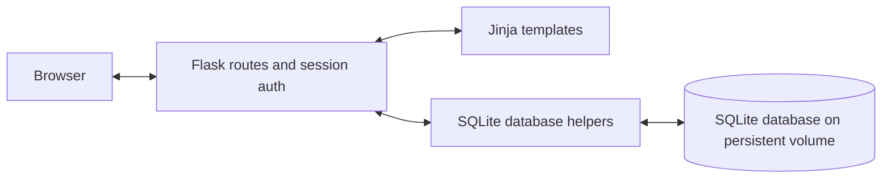

# Blog System MVP Architecture

## Architecture overview

The MVP is a single Flask application that renders HTML with Jinja and reads/writes a local SQLite database. It has no separate frontend build, API server, or external database service.



## Proposed project layout

```text
web/python_sqlite/
├── app.py                 # Application factory and route registration
├── config.py              # Environment-driven runtime configuration
├── db.py                  # Connection lifecycle and schema initialization
├── auth.py                # Register, login, logout, and login-required decorator
├── posts.py               # Public post views and protected post creation
├── schema.sql             # SQLite schema
├── templates/
│   ├── base.html
│   ├── index.html
│   ├── post_detail.html
│   ├── register.html
│   ├── login.html
│   └── new_post.html
├── static/
│   └── style.css
├── tests/
│   ├── conftest.py
│   ├── test_auth.py
│   ├── test_posts.py
│   └── test_storage_config.py
├── requirements.txt
├── README.md
├── proposal.md
├── archtirecutre.md
└── design.md
```

## Request and data flow

### Registration and login

1. Flask validates the submitted form and CSRF token.
2. Registration normalizes the username, validates the password, checks uniqueness, and inserts a password hash.
3. Login looks up the user by username and verifies the submitted password with Werkzeug's password-hash verifier.
4. On success, the session stores only the user's identifier. Logout clears the session.
5. A `login_required` guard redirects anonymous users to the login page for protected post creation.

### Creating and reading posts

1. The authenticated user submits a title and plain-text body to the protected create route.
2. Server-side validation rejects empty/oversized values.
3. The application stores title, body, owner id, and UTC creation time using a parameterized SQLite statement.
4. The index page queries recent posts; the detail route fetches a single post by id and returns 404 if absent.
5. Jinja autoescaping renders user-generated title/body as text. No user-authored HTML is trusted.

## Data model

### `users`

| Column | Type | Constraints |
| --- | --- | --- |
| `id` | INTEGER | Primary key |
| `username` | TEXT | Required, unique, normalized |
| `password_hash` | TEXT | Required; never store plaintext |
| `created_at` | TEXT | Required UTC timestamp |

### `posts`

| Column | Type | Constraints |
| --- | --- | --- |
| `id` | INTEGER | Primary key |
| `author_id` | INTEGER | Required foreign key to `users.id` |
| `title` | TEXT | Required, bounded length |
| `body` | TEXT | Required |
| `created_at` | TEXT | Required UTC timestamp |

Enable SQLite foreign-key enforcement on every connection. Add an index on post creation time (and author if useful) for recent-post listing. The initial schema is created idempotently at application startup or via an explicit initialization command.

## Persistent storage and configuration

- Read `COMRITE_CLOUD_DATA_VOLUME` from the process environment.
- If unset or empty, use `/app/data` as the data directory.
- Create the selected directory before opening SQLite.
- Place the default database at `<data directory>/blog.sqlite3`.
- Allow an explicit `DATABASE` configuration override for tests and development.
- Keep sessions signed with `SECRET_KEY`; production must provide a stable secret through environment configuration.
- Set secure cookie options in production when served over HTTPS. Keep `HttpOnly` and `SameSite=Lax`; document local-development overrides if required.

## Security and reliability

- Hash passwords with Werkzeug's current password hashing helpers and verify via the corresponding verifier.
- Enforce authorization in Flask route handlers; hiding a link is not access control.
- Use CSRF protection on all POST forms, including login and registration.
- Use parameterized SQL for every user-controlled value.
- Rely on Jinja autoescaping and do not render post text with a `safe` filter.
- Validate input length and handle duplicate-username/invalid-form conditions without leaking internal errors.
- Use a context-managed or request-scoped SQLite connection and close it after each request.
- Do not commit the live database, secrets, or uploaded/user data to source control.

## Test architecture

Use pytest and Flask's test client. An app fixture points `DATABASE` at a temporary file (or isolated in-memory database with correct connection handling); tests initialize the schema independently. Test registration/password hashing, login/logout, anonymous and authenticated post access, input validation, public display, and HTML escaping. A configuration test verifies the Comrite environment variable and fallback path without creating or replacing production data.

## Deployment boundary

The application is suitable for a small, single-instance deployment using a mounted persistent directory. SQLite is file-backed and should not be placed on an ephemeral container filesystem. If the deployment later needs multiple app instances with concurrent writes, migrate to a network database such as PostgreSQL rather than sharing a SQLite file across replicas.
